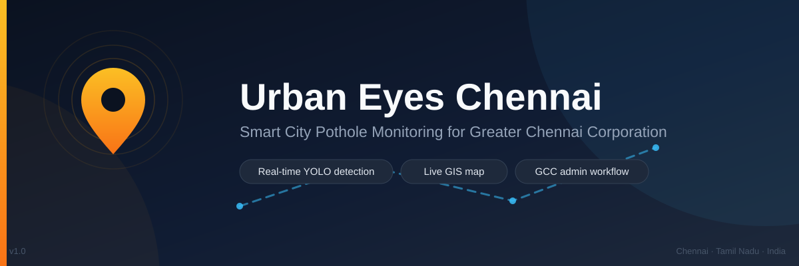

<div align="center">



# 👁️ Urban Eyes Chennai

**Smart city pothole monitoring & infrastructure survey system for the Greater Chennai Corporation (GCC).**

_Potholes on Chennai's roads — detected in real time by cameras on city buses, mapped live, graded by severity, and tracked from detection to repair._

</div>

<p align="center">
  
  
  
  
  
  <br />
  
  
  
  
  
  <br />
  
  
  
  
  
  <br />
  <a href="https://urban-eyes-yk0f.onrender.com/"></a>
</p>

---

## 🚀 Quick Start

> [!TIP]
> ```bash
> # 1. Install dependencies
> npm install
>
> # 2. Configure secrets
> cp .env.example .env   # add your GEMINI_API_KEY + MongoDB credentials
>
> # 3. Run
> npm run dev            # → http://localhost:3000
> ```

## 🌐 Live Deployment

> [!IMPORTANT]
> The app is hosted on **Render** at **https://urban-eyes-yk0f.onrender.com/**
> (Express API + built frontend served together on the same origin).

**Deploying to Render:**

1. Push this repo to GitHub, then in Render choose **New → Web Service** (or **Blueprint**) and connect the repo.
2. Set the build command to `npm run build` and the start command to `npm start` (the included [`render.yaml`](render.yaml) does this automatically when used as a Blueprint).
3. Add these environment variables in the Render dashboard (secrets are never stored in the repo):

   | Variable | Example |
   |----------|---------|
   | `NODE_ENV` | `production` |
   | `APP_URL` | `https://urban-eyes-yk0f.onrender.com` |
   | `GEMINI_API_KEY` | *(your Gemini key)* |
   | `MONGODB_USER` / `MONGODB_PASSWORD` | *(Atlas credentials)* |
   | `MONGODB_HOST` | `cluster0.uotjzrt.mongodb.net` |
   | `MONGODB_DB` | `urban-eyes` |

   > If MongoDB env vars are missing, the server logs `[MEMORY MODE]` and uses an in-memory store (data resets on restart).

4. Deploy — the server binds to Render's `PORT` automatically.

Point your edge devices at `https://urban-eyes-yk0f.onrender.com/api/potholes` (see the [edge device](#-edge-device-raspberry-pi) section).

## ✨ Features

|  |  |  |
|---|---|---|
| 🎥 **Real-time detection**<br/><sub>YOLO on Raspberry Pi buses with live GPS</sub> | 🗺️ **Live Chennai map**<br/><sub>Interactive Leaflet map of every pothole</sub> | 🤖 **AI severity grading**<br/><sub>SMALL / MEDIUM / LARGE via Gemini analysis</sub> |
| 🏛️ **GCC admin workflow**<br/><sub>DETECTED → SENT_TO_GCC → VIEWED → ACTION_TAKEN</sub> | 📊 **Analytics dashboard**<br/><sub>Per-route & per-severity stats with charts</sub> | 🔁 **Duplicate clustering**<br/><sub>10 m spatial dedupe keeps the map clean</sub> |

## 🏗️ Architecture

```
┌───────────────────────────┐         ┌───────────────────────────────────────────┐
│ Raspberry Pi (on the bus) │  HTTP   │ Urban Eyes server                         │
│                           │ ──────▶ │  Express API  (MongoDB / memory)         │
│  CSI/USB camera           │         │  React dashboard · map · admin · stats   │
│  NEO-6M GPS → main.py     │         │  Firebase / Firestore · Gemini AI        │
└───────────────────────────┘         └───────────────────────────────────────────┘
```

## 🧰 Tech Stack

| Layer | Technology |
|-------|------------|
| 🖥️ Frontend | React 19 · TypeScript · Vite · Tailwind CSS v4 |
| 🗺️ Maps | Leaflet + react-leaflet |
| 📈 Charts | Recharts |
| ⚙️ Server | Express (`server.ts`) |
| 🗄️ Database | MongoDB Atlas (with automatic in-memory fallback) |
| ⚡ Realtime | Firebase Firestore |
| 🤖 AI | Google Gemini (`@google/genai`) |
| 📡 Edge device | Python · YOLO (`edge/main.py`) |

## 🧑‍💻 Getting Started

**Prerequisites:** Node.js 18+

<kbd>1</kbd> **Install dependencies**

```bash
npm install
```

<kbd>2</kbd> **Configure environment variables**

Copy `.env.example` to `.env` and fill in your values:

```bash
cp .env.example .env
```

| Variable | Purpose |
|----------|---------|
| `GEMINI_API_KEY` | Google Gemini API key (required for AI analysis) |
| `APP_URL` | Public URL where the app is hosted |
| `DATABASE_URL` | **Preferred:** PostgreSQL connection string (e.g. Tiger Cloud free tier). When set, detections persist across restarts/redeploys. |
| `MONGODB_USER` / `MONGODB_PASSWORD` | MongoDB Atlas credentials (fallback when `DATABASE_URL` is absent) |
| `MONGODB_HOST` | Atlas cluster host (default: `cluster0.uotjzrt.mongodb.net`) |
| `MONGODB_DB` | Database name (default: `urban-eyes`) |

> [!NOTE]
> If neither PostgreSQL (`DATABASE_URL`) nor MongoDB is configured/reachable,
> the server logs `[MEMORY MODE]` and uses an in-memory store so the
> dashboard, map, and admin flows still work for demos.
> Data resets on restart.

<kbd>3</kbd> **Run the app**

```bash
npm run dev
```

The server starts on **http://localhost:3000** — it serves the API and the Vite frontend together.

## 🔌 API Reference

| Method | Endpoint | Description |
|--------|----------|-------------|
| `POST` | `/api/potholes` | Report a pothole detection from an edge device (10 m duplicate clustering) |
| `GET` | `/api/potholes` | List all potholes, newest first |
| `PATCH` | `/api/potholes/:id` | Update status / remarks (GCC admin action, appends to history) |
| `GET` | `/api/stats` | Analytics: totals, per-route and per-severity counts |

### Example — report a detection

```bash
curl -X POST http://localhost:3000/api/potholes \
  -H "Content-Type: application/json" \
  -d '{
    "latitude": 13.0827,
    "longitude": 80.2707,
    "confidence": 0.87,
    "busRouteId": "21G",
    "busId": "CHN-BUS-7822",
    "bboxSize": 18240
  }'
```

## 📡 Edge Device (Raspberry Pi)

The `edge/` folder contains the on-bus detector: it captures frames, runs a
pothole-trained YOLO model (NCNN / ONNX / PyTorch), reads live GPS, and POSTs
detections to the server. See **[edge/README.md](edge/README.md)** for hardware,
setup, GPS wiring, model export, and boot auto-start instructions.

```bash
cd edge
chmod +x setup.sh && ./setup.sh     # one-shot Pi setup
source .venv/bin/activate
python main.py --verbose            # run the detector
```

No hardware yet? `python main.py --simulate` generates simulated detections to verify the full pipeline end-to-end.

## 📁 Project Structure

```
├── server.ts                  # Express API + Vite middleware
├── assets/                    # README banner & media
├── src/
│   ├── components/            # Dashboard, PotholeMap, PotholeList, AdminPanel
│   ├── lib/                   # Firebase / Firestore setup & helpers
│   ├── services/              # Gemini AI integration
│   └── types.ts               # Pothole, status, severity, stats models
├── edge/                      # Raspberry Pi YOLO detector (Python)
├── firestore.rules            # Firestore security rules
├── security_spec.md           # Security spec + "Dirty Dozen" test payloads
└── public/                    # Sample pothole photos
```

## 🛡️ Security

- 🔐 Secrets (`GEMINI_API_KEY`, MongoDB credentials) are read from environment variables and are **not** committed
- 🧩 Firebase client config is public by design (Firebase Web apps); access is enforced by `firestore.rules`
- 🧪 Server-side validation and update restrictions are specified in **[security_spec.md](security_spec.md)**, including the "Dirty Dozen" test payloads

---

<p align="center">
  <sub>Built with ❤️ in Chennai · Urban Eyes Chennai · Greater Chennai Corporation</sub>
</p>
